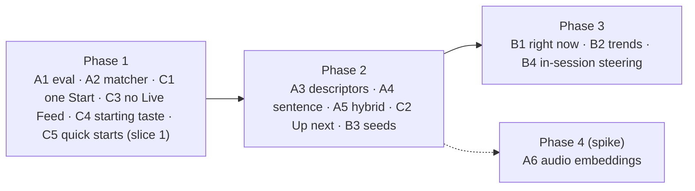

# Roadmap — AI DJ: meaning-aware retrieval, context, and a clearer session page (approved, 2026-10-22)

**Status:** scope approved by the owner on 2026-10-22. Work items are filed as
sub-issues of [#1952](https://github.com/akoita/resonate/issues/1952)
(#2235–#2249). The deployment half is
[resonate-iac#302](https://github.com/akoita/resonate-iac/issues/302). No
milestone is assigned yet: the split into one or two Vision Sprints is still
open (§8).
**Owner:** [@akoita](https://github.com/akoita)
**Parents:** [#1952](https://github.com/akoita/resonate/issues/1952) (taste
engine) and [#1447](https://github.com/akoita/resonate/issues/1447) (discovery
intelligence).
**Related:** [Taste engine milestone plan](2026-10-taste-engine-milestones.md) ·
[RFC: Taste Engine](../rfc/taste-engine.md) ·
[Discovery Intelligence RFC](../rfc/discovery-intelligence.md) ·
[Agent taste intelligence](../features/agent_taste_intelligence.md)

**Revenue line (ADR-BM-6):** vision-neutral quality and infrastructure. This
plan changes no fee, split, price, payout or purchase path. The paid Session DJ
features and pay-per-play stay on line 4 (Listener Pro) behind their existing
gates ([#1971](https://github.com/akoita/resonate/issues/1971),
[#1972](https://github.com/akoita/resonate/issues/1972)). ADR-BM-4 and the six
recommendation rules (ADR-TE-2) apply unchanged: popularity can never be a
payout input, and ranking is never for sale.

---

## 1. Why this plan exists

Listeners and the owner report three problems:

1. **Requests miss obvious tracks.** A "World" session misses tracks whose
   genre text does not contain a word the DJ expects, and similar gaps
   appear for other genres.
2. **The DJ reads too few signals.** Competitors combine listening habits,
   playlists, trends and the time of day. Our DJ mostly follows release
   metadata.
3. **The session page is hard to understand.** It has three Start buttons,
   a "Next AI Pick" card that even the owner finds unclear, and a "Live Feed"
   card of doubtful value.

### What is already planned or shipped, and why it does not cover this

| Item | State | Covers the reported problem? |
| --- | --- | --- |
| [#2088](https://github.com/akoita/resonate/issues/2088) genre families, semantic retrieval, explicit preference | Closed 2026-10-04 (PR [#2090](https://github.com/akoita/resonate/pull/2090)) | Partly. See §2: both the families and the embeddings still come from the same free-text genre field |
| [#2037](https://github.com/akoita/resonate/issues/2037), [#2052](https://github.com/akoita/resonate/issues/2052), [#2059](https://github.com/akoita/resonate/issues/2059), [#2056](https://github.com/akoita/resonate/issues/2056), [#2096](https://github.com/akoita/resonate/issues/2096) prompt, presets, filter priority, dead-end fix, history filters | Closed | Built the current page; no later UX review |
| [#1452](https://github.com/akoita/resonate/issues/1452) content embeddings, [#1959](https://github.com/akoita/resonate/issues/1959)/[#1960](https://github.com/akoita/resonate/issues/1960) measured tempo, key and energy, [#1455](https://github.com/akoita/resonate/issues/1455) measurement | Closed | Foundations this plan builds on |
| [#1971](https://github.com/akoita/resonate/issues/1971) Session DJ (mixing, energy arc) | Open, gated on Listener Pro WAU | No. It covers mixing and the paid tier, not retrieval or page clarity |
| [#1453](https://github.com/akoita/resonate/issues/1453) collaborative filtering | Open, gated on real traffic | No. It covers habits from other listeners, later |
| [#251](https://github.com/akoita/resonate/issues/251) listening analytics and habit tracking | Closed 2026-10-22 as superseded, with a pointer to #2236, #2245 and #2247 | Superseded by My Mix lanes and this plan |

**Conclusion:** no open issue or roadmap entry covers retrieval quality beyond
#2088, context-aware session starts, or the session page UX. This plan fills
that gap.

## 2. Diagnosis (code as of 2026-10-22)

### R1 — Retrieval is still gated by free-text metadata

- Keyword candidates come from `catalog.search`, which matches the query
  against `release.genre` or the title, 20 results per query
  (`backend/src/modules/agents/agent_selector.service.ts`). The query terms
  are expanded with a **hard-coded** family list
  (`backend/src/modules/recommendations/genre_families.ts`). A release whose
  genre is a label the list does not know ("Bambara", "Kora", "Sahel blues",
  "Ethio-jazz", a country name) or is empty never matches. Any list we keep
  by hand will always be incomplete.
- "Semantic" retrieval (#2088) embeds the session description and looks for
  nearest neighbours. However, the **track vector is embedded from the same
  metadata**: title, artist, release title, genre and moods
  (`backend/src/modules/embeddings/track_embedding_text.ts`). A track with a
  weak or missing genre therefore also has a weak vector. A fixed similarity
  floor (`AGENT_SEMANTIC_MIN_SIMILARITY`, default 0.55) and a limit of 20 then
  cut it off.
- Measured audio features (tempo, key, energy, #1959) only **re-rank**
  candidates that were already found. They never **retrieve** a track. For
  example, a "calm" session cannot find a low-energy track that has no
  "calm" mood tag.

### R2 — The listener's sentence is reduced to fixed vocabulary chips

The prompt "What's this session for?" is parsed by rules into genre, mood,
energy and tempo chips. The page says the sentence "is read once … and is
not saved". The semantic query is then rebuilt from the preset name and the
chips (`buildSemanticSessionQuery` in
`backend/src/modules/agents/deterministic_recommendation.adapter.ts`).
Anything the rules did not catch is lost. That includes activities
("cooking"), places, eras, instruments, languages and artist names, which
the User Guide already admits ("the DJ does not understand artist names
yet").

### R3 — Two matchers disagree

The ordinary session path uses `genreMatchesRequest` (genre families). The My
Mix lane path (`laneSessionRequestMatch` in
`backend/src/modules/recommendations/discovery-ranking.service.ts`) uses exact
canonical equality against the taste-edit vocabulary. The same track can
therefore match a "World" session and not match a "World" lane. My Mix lanes
are also built only from that canonical vocabulary
(`backend/src/modules/agents/listening_lanes.ts`). A listener whose history is
mostly free-text genres may never be offered My Mix. Verify this for an
account with many sessions: the screenshot that prompted this plan shows 39
sessions and no My Mix quick start.

### R4 — Context the DJ already has but does not use at session start

| Signal | Exists today | Used by the DJ? |
| --- | --- | --- |
| Time of day and weekday (`localHourBucket`, `weekdayKind`) | Recorded on signals; weights My Mix lanes when My Mix is chosen | Only inside My Mix; not for quick starts, defaults or the "no filters" case |
| Trending and popularity serving tables (`DiscoveryPopularityService`, WS-4) | Used by Home ("Trending in <genre>") | No |
| Playlists (`Playlist`, playlist-add signal weight 3) | Taste signal only | No session can be seeded from a playlist |
| Seed track or artist ("more like this") | `TrackEmbeddingService.neighboursOfVector` exists | No. It was the #2088 follow-up and was never filed |
| In-session feedback (skip, save) | Fed back into learning between sessions | Not used to steer the current session |

### R5 — Session page UX

What the page shows today and where it comes from in the code:

- **Three Start buttons** with the same function. The command bar
  (`AgentSessionPanel.tsx`), the status card (`AgentStatusCard.tsx`) and the
  prompt (`AgentSessionPrompt.tsx`, through `handleSubmit`) all call
  `handleToggle()` while no session is running. Once a session is live, the
  prompt button becomes "Update session" and the other two become "Stop
  Session". The listener's name and status appear twice (command bar and
  status card). `AgentDashboard.tsx` holds a fourth copy, but no page imports
  it (dead code).
- **Next AI Pick** (`AgentNextPickCard.tsx`):
  - The name suggests a preview, but the button **plays** a new pick at once
    and replaces what the player was going to play next. The continuation
    already keeps the set going on its own, so the button acts as a
    "skip and re-roll" with an unclear label.
  - When idle, it shows a disabled red-orange button that looks like an
    error. It shows the last pick only, not what comes next.
  - It shows developer data: `score 42`, runtime status strings ("no
    tracks", "Runtime"), "Rule-based pick · AI curator unavailable". The
    artist and artwork are missing, as the code comment notes.
- **Live Feed** (`AgentActivityFeed.tsx`): before a session it shows two
  hard-coded placeholder lines plus a third line that repeats them. During a
  session it streams backend events (`agent.selection`, `agent.mix_planned`,
  `agent.decision_made`, and `agent.negotiated` with a 💰 icon left from the
  retired buy mode). This is an operator log, not listener value. The only
  listener-relevant parts are the request coverage ("3 of 5 picks matched")
  and the reason for a pick.
- **Status card** (`AgentStatusCard.tsx`): the chips under the DJ's name
  (Chill, Deep House, Lo-fi…) are the DJ's **saved vibes**. Nothing on the
  card says what they do or where to change them. They have two effects
  listeners cannot guess:
  1. With no filters, the session plays from these vibes ("No filters yet:
     the DJ will choose from your saved vibes").
  2. When the filters name a mood but no genre, the vibes silently become
     the session's genres (`buildSessionPreferences`, `fallbackGenres` in
     `AgentSessionPanel.tsx`). A "Static Calm" session is therefore limited
     to Chill, Deep House, Lo-fi and so on, without saying so.

  They are edited in Settings → AI DJ, linked only by a hint at the bottom
  of the page. They also overlap two other taste concepts: the learned taste
  managed in Settings → Taste memory, and the My Mix habit lanes. Listeners
  cannot tell which of the three steers a session. The "39 sessions · 291
  tracks" counts take up space without leading to an action.

## 3. Principles and cost guardrails

1. **Meaning over labels, labels as hints.** Genre text helps retrieval but no
   longer gates it. Retrieval combines keyword, semantic, audio-feature,
   habit and trend sources (hybrid), each bounded.
2. **Pay once per track, not once per pick.** Expensive understanding (model
   tagging, audio embeddings) runs once at ingestion or as a backfill, is
   stored and versioned, and is recomputed only when the content hash changes.
   This is the same pattern as #1452 and #1959.
3. **At most one model call per session start, none per pick.** The listener's
   sentence is understood once: rules first, a model only for what the rules
   could not read, behind a strategy flag with a deterministic fallback. This
   follows the `TASTE_EDIT_PARSER_STRATEGY` pattern. The query embedding is
   cached per session.
4. **No online warehouse scans on the pick path.** Trending and habits come
   from serving tables and Postgres, as the Discovery Intelligence RFC already
   requires. Every new source has a candidate budget and a latency budget, and
   fails open: a source error only removes its own candidates.
5. **Measured before promoted.** Every retrieval change is gated on the golden
   eval and offline recall@k (#1455). It ships behind the existing ranker
   variant labels (#2005) and is promoted only on a measured win.
6. **Honest when it cannot.** An unmet request stays visible as unmet
   (ADR-TE-4). Widening is shown, never hidden.

### Indicative running cost

These are orders of magnitude. Verify them against current provider pricing
before approval.

| Item | When it runs | Indicative cost |
| --- | --- | --- |
| Model tagging of a track from its metadata (WS-A3) | Once per track, then only on metadata change | Fractions of a cent per track; a one-off backfill of the current catalog stays well under a few dollars |
| Text embedding of the enriched track descriptor | Once per track (already budgeted under #1452) | Unchanged order of magnitude |
| Session sentence understanding (WS-A4) | Once per session start, only when the rules leave something unread | About one small-model call per session; negligible at current traffic |
| Session query embedding | Once per session, cached | Already paid today by #2088 |
| Audio embeddings (WS-A6, only if the spike wins) | Once per track on the existing worker | CPU seconds per track; no per-pick cost |
| Trending, habits, seeds | Per pick, from Postgres or serving tables | No external cost; bounded queries |

New configuration (strategy flags, budgets, scheduled backfills) is documented
in `docs/deployment/environment.md`, and its deployment half is tracked in a
cross-linked `resonate-iac` issue, as `CLAUDE.md` requires.

## 4. Recommendations on the three panels

| Panel | Recommendation | Why |
| --- | --- | --- |
| **Start buttons** | **Keep one primary action**: the prompt's "Start session" / "Update session". Show a "Stop" control in the command bar only while live. Remove the status-card button. | The three buttons do the same thing, and only the prompt button carries what the listener typed or picked. |
| **Next AI Pick** | **Replace with a "Now & Up next" card.** It shows the playing DJ track and the next 2–3 picks with artwork, artist and one plain reason. Actions: **Skip**, **Not this** (negative feedback that refills the queue), **More like this** (seed-track neighbours). Idle state: no disabled button, one line pointing to the prompt. Remove the score and runtime strings. A rule-based fallback reads "Picked from your filters" rather than mentioning an unavailable AI. | The listener needs to see what is coming and steer it; they do not need a re-roll button. The actions turn into in-session signals (R4). |
| **Live Feed** | **Remove the card.** Move its two useful parts: request coverage ("3 of 5 matched World") becomes one line under the filter chips, and the reason for each pick appears on the Up next items. Keep the raw event stream for operators (admin or debug view). | It is an engineering log on a listener page, with placeholders before the session and a leftover purchase icon. |
| **Status card** | Merge into the command bar (name, live state, Stop). Move the session and track counts to Session History or Sonic Radar. Replace the bare vibe chips with one labelled line in the prompt's empty state: "With no filters, your DJ starts from: Chill, Deep House… · Edit", linking to Settings → AI DJ. Stop using the vibes as hidden genres for mood-only sessions (see C4). | It duplicates identity and an action, and its chips have an effect the listener cannot see or find. |

This simplifies the page into: **prompt (start or update) → Now & Up next →
session history and Sonic Radar**.

## 5. Work items

Sizes: S ≤ 2 days, M ≤ 1 week, L > 1 week, solo with AI assistance.
Every item carries `vision:core`, the revenue-line statement above, focused
tests, and feature-page and User Guide updates in the same PR.

### Phase 1 — Measure, then fix the cheap causes (one sprint)

| ID | Draft issue | Priority | Size | Notes |
| --- | --- | --- | --- | --- |
| A1 · [#2235](https://github.com/akoita/resonate/issues/2235) | **AI DJ retrieval golden set**: add golden cases to `agent_golden_eval` and the offline eval. Cases: World → releases labelled African, Mandingue, a country name, or with no genre; Rap → explicit rap when allowed; "cooking", "focus" and "run" sentences; an artist name; a calm request against a measured low-energy track with no mood tag. Report recall@k per case. | P0 | S | Gate for every A item. Also the #2088 follow-up "golden cases World → African" |
| A2 · [#2236](https://github.com/akoita/resonate/issues/2236) | **One genre matcher**: My Mix lanes and the lane request match use `genre_families` like the ordinary path. Lanes are built from family ids, not only the canonical vocabulary. Investigate and fix why a listener with dozens of sessions is not offered My Mix. | P0 | S | Bug (R3) |
| C1 · [#2237](https://github.com/akoita/resonate/issues/2237) | **Session page: one Start action**: remove the status-card Start and merge the status card into the command bar; Stop only while live; delete the unused `AgentDashboard.tsx`. | P0 | S | R5 |
| C3 · [#2238](https://github.com/akoita/resonate/issues/2238) | **Remove the Live Feed card**: request coverage moves under the chips; the event stream moves to an operator view; drop the `agent.negotiated` icon mapping. | P1 | S | R5 |
| C4 · [#2239](https://github.com/akoita/resonate/issues/2239) | **Make the DJ's starting taste visible and editable in place**: a labelled "starts from" line with an inline Edit link to Settings → AI DJ. A mood-only session no longer narrows to the saved vibes; it searches all genres and ranks by learned taste. Settings → AI DJ and the User Guide explain how saved vibes, Taste memory and My Mix differ, in one short table. | P1 | S | R5. Decide whether saved vibes should eventually merge into the declared layer of Taste memory (taste engine RFC, five layers) |
| C5 · [#2249](https://github.com/akoita/resonate/issues/2249) | **Quick starts that show what the DJ can do**: plain-language starters in three rows (For you, Moments, Sounds) that write their sentence into the prompt; mood starters set mood, energy and tempo but no hidden genres; Sounds come from catalog families with enough playable tracks; composable optional filters (energy, tempo, Familiar ↔ New discovery, explicit). Delivered in slices: copy and composition first, catalog-aware Sounds next, For you once #2244/#2245 land. | P1 | M | R5. Replaces the jargon mood presets (Neural Flow, Pulse Raid…) |

### Phase 2 — Meaning-aware retrieval and the Up next card (one to two sprints)

| ID | Draft issue | Priority | Size | Notes |
| --- | --- | --- | --- | --- |
| A3 · [#2240](https://github.com/akoita/resonate/issues/2240) | **Enriched track descriptors**: a stored, versioned descriptor per track. It holds the normalized genre families and sub-genres from a model reading of the free-text genre, title, release description and artist profile (country or region when the artist declared it), plus measured tempo and energy bands and vocal or instrumental. The tags are generated once per track, re-validated against the family list, and visible and correctable by the artist. Re-embed tracks from the descriptor. | P0 | M | Removes the "genre must contain the word" failure at the source. Pay once per track (§3.2) |
| A4 · [#2241](https://github.com/akoita/resonate/issues/2241) | **Read the listener's sentence for meaning**: the raw sentence (bounded, never stored or logged, as today) joins the semantic query for that session. A model-assisted parser behind `AGENT_SESSION_PARSER_STRATEGY` (default deterministic) reads what the rules left unread: activity, era, instrument, language, artist names. Artist names resolve to catalog artists and become seed neighbours. Unread parts stay visible as "Didn't catch". | P0 | M | R2. One model call per session start at most |
| A5 · [#2242](https://github.com/akoita/resonate/issues/2242) | **Hybrid retrieval with budgets**: merge the keyword, semantic, audio-feature range (energy and tempo retrieve, not only re-rank), My Mix lane and seed sources with reciprocal-rank fusion. Each source has a candidate budget. Replace the fixed similarity floor with top-k plus a calibrated floor tuned on A1. Ship behind a ranker variant and promote on a measured win. | P0 | M | R1. No new external cost |
| C2 · [#2243](https://github.com/akoita/resonate/issues/2243) | **"Now & Up next" card** replaces Next AI Pick (see §4), with Skip, Not this and More like this. "Not this" writes the existing skip or downrank signal and refills; "More like this" seeds neighbours of the current track. | P0 | M | R5 + R4 |
| B3 · [#2244](https://github.com/akoita/resonate/issues/2244) | **Seeded sessions**: start a session from a track ("More like this"), an artist, or one of the listener's playlists (centroid of its track vectors plus its family mix). | P1 | M | R4 |

### Phase 3 — Context and trends (one sprint)

| ID | Draft issue | Priority | Size | Notes |
| --- | --- | --- | --- | --- |
| B1 · [#2245](https://github.com/akoita/resonate/issues/2245) | **Right-now start**: when the listener gives no filters, the DJ uses the current time of day and weekday to weight their habit lanes (the My Mix context logic) instead of the flat saved vibes. A "Right now" quick start, with a visible reason such as "your usual weekday-evening mix". | P1 | S | R4. No new data |
| B2 · [#2246](https://github.com/akoita/resonate/issues/2246) | **Trends as a bounded source**: "trending in your families" from the popularity serving tables, capped at a share of candidates. It never outranks the session request, never counts listener money, and passes the minimum-audience threshold. | P2 | S | R4. ADR-TE-2 and ADR-BM-4 hold |
| B4 · [#2247](https://github.com/akoita/resonate/issues/2247) | **In-session steering**: skips and saves in the current session shift the remaining picks within the session (short-term vector), not only the long-term profile. | P2 | M | R4 |

### Phase 4 — Audio understanding (spike, eval-gated)

| ID | Draft issue | Priority | Size | Notes |
| --- | --- | --- | --- | --- |
| A6 · [#2248](https://github.com/akoita/resonate/issues/2248) | **Spike: audio embeddings in a joint text-audio space** (CLAP-style model on the existing worker, once per track). Text queries ("kora and soft vocals") then reach tracks by sound even with no useful metadata. Promote only if it beats A3 + A5 on the A1 set at an acceptable worker cost; otherwise record the result and close. | P2 | M (spike) | Licence of the model weights must allow commercial use; check before adoption |

Out of scope here and unchanged: mixing and the energy arc (#1971),
collaborative filtering (#1453), pay-per-play (#1972), and the taste passport
(#1973).

## 6. Suggested sequencing

Phase 1 is low-risk and quick to show. Phase 2 addresses the root cause the
listener sees. Phase 3 adds the "competitor" signals once retrieval is sound.
Phase 4 runs only if the eval shows a remaining gap.

## 7. Exit criteria

- On the A1 golden set, every World and Rap case reaches its expected tracks
  in the top 20, including tracks with no "world" or "rap" in their metadata.
- The session page has one start action, no Live Feed card, and an Up next
  card that shows what is coming and lets the listener steer it.
- No model call happens on the pick path. At most one happens per session
  start, and none when the rules read the whole sentence.
- Per-surface skip rate and resonant discoveries (#1455) do not regress under
  the promoted variant.

## 8. Open questions for the owner

1. Should the model-assisted session parser (A4) be on by default once it
   passes the eval, or opt-in per environment?
2. Should artists see and correct the generated descriptor tags (A3) in the
   release editor from day one, or should that follow later?
3. Should "Right now" (B1) replace the default empty state, or sit beside the
   quick starts?
4. Should this become one Vision Sprint after Sprint 32, or be split across
   two?
5. Should saved vibes stay a separate DJ setting, or merge into the declared
   taste in Taste memory so that one place controls the starting taste?
